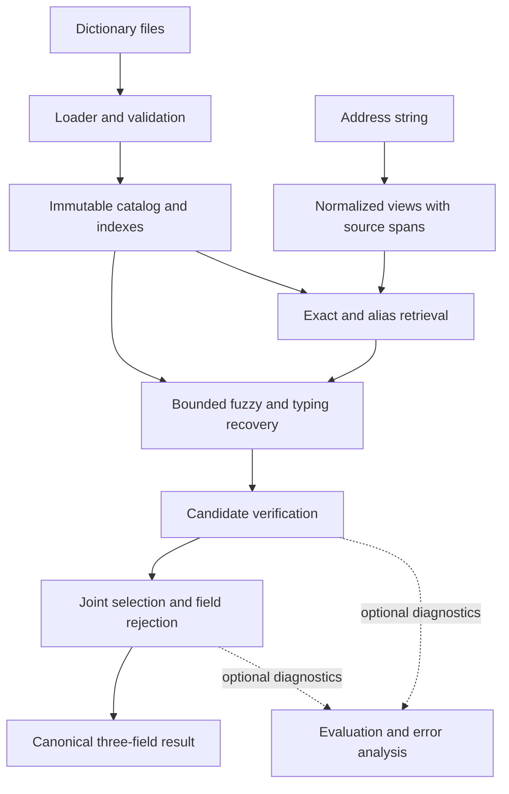

# Address segmentation architecture and execution plan

This design turns [the requirements plan](address-segmentation-plan.md) into independently testable implementation stages. Build a synchronous, standard-library Python matcher, prepare dictionaries once, and isolate the grader protocol from matching. Keep evaluation and benchmark tooling outside the submission package. The requirements plan remains authoritative for provenance and scope.

User decisions on 2026-11-04: official materials are unavailable, so use controlled fixtures; return `None` for unresolved ambiguity. CPython 3.14 remains provisional. The local interpreter is 3.14.4. No external datasets, dependencies, or geographic relationships are needed for the foundation.

## Component boundaries



Use a small package from the start. This refines the original plan's optional single-file baseline: module boundaries make individual algorithms and benchmark failures easier to inspect. If the grader demands one file, adapt packaging at the release stage and test that exact artifact; do not maintain two implementations.

| File or directory | Responsibility |
| --- | --- |
| `address_segmentation/model.py` | Field names, entries, candidates, configuration, trace records |
| `address_segmentation/catalog.py` | Validate label sequences; preserve canonical text; assign stable IDs; collision-safe lookup indexes |
| `address_segmentation/normalize.py` | NFC, casefold, accent folding, tokens, original offsets; preserve numeric names |
| `address_segmentation/retrieve.py` | Exact token windows/trie, explicit aliases, then indexed approximate retrieval |
| `address_segmentation/verify.py` | Bounded edit explanations, complete-name coverage, context features |
| `address_segmentation/select.py` | Compatible combinations, absolute acceptance, competing-label margins, null policy |
| `address_segmentation/matcher.py` | Prepare once; coordinate stages; fresh result per call |
| `address_segmentation/io.py` | Provisional JSON dictionary loader and JSONL adapter |
| `address_segmentation/__init__.py` | Export `AddressMatcher` only as the stable application API |
| `submission.py` | Eventually implement the official grader interface; no speculative global data loading |
| `tools/evaluate.py`, `tools/benchmark.py`, `tools/preflight.py` | Offline development commands with machine-readable reports |
| `tests/fixtures/`, `tests/test_*.py` | Handwritten challenge data, schema and behavior tests |
| `benchmarks/` | Dataset generators, manifests, frozen configurations; no runtime dependency |
| `reports/` | Generated experiment outputs, excluded from submission |

Create modules when their stage needs them, rather than filling the package with placeholder classes. Dependencies point from orchestration toward pure transformations. The core never imports development tools, performs network access, reads files during a request, or prints.

## Data and API contracts

```python
matcher = AddressMatcher(streets=streets, wards=wards, provinces=provinces)
result = matcher.identify(address)
# Always a fresh dict: {"street": str | None, "ward": str | None,
#                      "province": str | None}
```

The constructor accepts finite sequences of nonblank strings. Reject a string passed as a sequence, malformed labels, and wrong field types with descriptive exceptions. Empty dictionaries are valid. Deduplicate identical labels within a field; retain labels that differ even if normalized keys collide. Stable IDs derive from sorted `(field, canonical_label)` values, never input order. IDs are internal and can change when dictionaries change. Preserve canonical whitespace, case, accents, and prefixes exactly in output.

`identify` accepts only `str`; non-string inputs raise `TypeError`. Empty, whitespace-only, and punctuation-only strings yield three nulls. Do not swallow installation or implementation exceptions. Request state is local, with no cross-request prediction cache in the baseline.

The provisional fixture dictionary is UTF-8 JSON:

```json
{"streets": ["Nam Kỳ Khởi Nghĩa", "3/2"], "wards": ["Phường Bến Thành"], "provinces": ["Thành phố Hồ Chí Minh"]}
```

Evaluation cases use JSONL records with `id`, `address`, `expected` (the three-field object), `tags`, `group_id`, and `expectation_kind` (`recoverable`, `unsupported`, or `ambiguous`). Ambiguous fields have null expectations under the current policy. Each expected non-null label must exist in its field's fixture dictionary. Explicit alternative expectations, if needed for research, belong in separate diagnostic annotations, never silently relaxed scoring.

The development CLI loads an explicit `--dictionary PATH` once and accepts one JSON string per stdin line, returning one result object per line. Errors go to stderr with nonzero exit status; stdout contains results only. This is a development protocol, not a claim about the grader. Relative user paths resolve from the caller's working directory; bundled fixture defaults resolve from the script/module location. `submission.py` remains deferred until the contract arrives.

## Evidence representation

An `Entry` contains ID, field, canonical label, and precomputed search forms. Each index key maps to all matching IDs. Aliases carry their origin and explicit target ID. Automatically derived initials are weaker evidence than supplied aliases. Never assume `LTK` means `Lý Thường Kiệt` without a documented alias or an explicitly enabled initials hypothesis; the fixture may supply that relationship.

A `TextView` contains normalized text/tokens and original half-open source spans. Normalize base characters together with combining marks, including decomposed Vietnamese input; expansions from casefolding and collapsed whitespace must map back to the entire contributing source span. Do not compute offsets by indexing a normalized string into the original. Assert that candidate spans are in bounds and represent their source evidence.

A `Candidate` contains entry ID, field, original span, retrieval paths, verification cost, coverage, contextual features, and acceptance reasons. Merge duplicate `(entry ID, source span)` candidates without adding duplicated evidence scores. Separate occurrences of a label remain separate candidates. Numeric separators remain meaningful: `3/2` must not become `32`; slash-separated house numbers are not automatic street matches.

Diagnostic mode returns a separate trace alongside the result through an internal development API. Trace stage counts, budget exhaustion, rejected candidates and reasons, and competing interpretations. Public results never acquire diagnostic keys. Disable detailed traces for primary latency measurements and measure tracing overhead separately.

## Retrieval and verification

1. Prepare canonical, casefolded NFC, and accent-folded token forms. Recognize administrative prefixes as context, retaining the original tokens. Index prefix-stripped name forms only with field-specific rules.
2. Find complete exact/alias token sequences. Begin with token windows bounded by the longest indexed name; move to a trie only if measured worthwhile. Respect word boundaries and numeric separators. Preserve prefix matches for later competition.
3. Recover candidates for unresolved spans and suspicious exact prefixes. An exact `An Phú` inside `phuong an phu dnog` must not suppress a longer fuzzy hypothesis. Skip fuzzy work only when complete-component evidence is sufficient and no unexplained adjacent name tokens remain.
4. Retrieve approximate names using character n-gram postings and length buckets. Start with trigrams for long names; use separate bounded paths for short names, initials and numeric names. Never compare every street against every window. Retrieve typing-aware variants before applying ordinary edit-distance length pruning, because their edits may consume multiple characters.
5. Verify shortlisted candidate/span pairs. Start with thresholded adjacent-transposition edit distance with documented semantics (optimal string alignment is acceptable initially). Compare full candidate names with spans, not whole addresses. Keep literal and typing hypotheses competing. Numeric names need exact numeric evidence in the initial policy.
6. Add compact-space and Telex/VNI verification as independent feature switches. Keyboard-neighbor costs are last and disabled until ablation shows a useful tradeoff. No global rewrite of modifier letters/digits and no unconditional terminal-`l` deletion.

Index build complexity and memory are reported against total dictionary characters and postings. Exact scanning depends on input tokens and maximum name length; approximate verification depends on explicit operation budgets. These bounds describe work, not guaranteed wall-clock time.

## Selection and ambiguity

Keep up to K candidates per field plus null, with deterministic sorting. Start experiments at K = 8 (at most 729 triples); sweep 4, 8, and 16 while measuring recall before and after pruning. K is a benchmark parameter, not a correctness guarantee. Deduplicate label/span evidence before pruning and preserve multiple source spans where compatibility differs.

Reject combinations that reuse overlapping name evidence for different fields. Repeated occurrences at distinct spans can support different fields. Markers, component boundaries, full-name coverage and correction cost determine evidence; field order is only a soft feature. Longer names do not automatically win. Do not infer unmentioned components or add geographic constraints without supplied relationships.

Use a documented additive score with named feature contributions and fixed configuration. Establish exact-only selection first; calibrate fuzzy costs and absolute acceptance thresholds on development data. Keep numeric values in configuration, not scattered constants. No automatic parameter fitting or ML is required.

A field is emitted only if its candidate passes an absolute evidence threshold and its canonical label remains unambiguous across the best compatible interpretations within a configured score margin. Compare against the best interpretation with a different label (including null) for that field. Multiple spans yielding the same label are not label ambiguity. Evaluate ambiguity before deterministic ordering resolves ties; retain enough alternatives to detect ties, including candidates at a pruning boundary. If pruning prevents establishing uniqueness, abstain for the affected field and record the reason. A reliable province can survive an ambiguous ward.

For the exact baseline, two equally supported canonical labels yield null; an accented exact match outranks an accent-folded collision. An unmarked span shared across fields must not be assigned to both. Tests establish this behavior before adding arbitrary score weights.

## Work budgets

Start profiling with these experimental bounds: 128 approximate span hypotheses, 64 shortlisted entries per span, 2,048 verified pairs per address, and K = 8 for selection. Track postings visited as well as output candidate count; capping the shortlist alone does not bound retrieval work. Add a postings-visit budget after measuring real distribution. Dictionary-driven exact windows remain separate from fuzzy budgets.

Budget consumption follows deterministic priority order (explicit context, component completeness, retrieval strength, stable ID). When a fuzzy budget is exhausted, retain independently supported exact fields and abstain where unresolved competition matters. Report exhaustion rate and accuracy conditional on exhaustion. Never silently claim an exhaustive search. Use operation counts, not elapsed-time cutoffs, to keep predictions reproducible.

Do not silently truncate long input. Linear normalization alone prevents an unconditional 100 ms guarantee for unlimited strings. Until official length limits arrive, test progressively longer strings and report supported measured ranges; input rejection limits require an explicit contract decision.

## Testing and benchmark design

Use `unittest` and deterministic generators with recorded seeds. Test public behavior and nontrivial algorithm invariants rather than mirroring implementation details.

| Suite | Required evidence |
| --- | --- |
| Catalog and contract | Exact keys/types, canonical membership, fresh results, empty dictionaries, malformed data errors, duplicate/permuted dictionaries |
| Normalization and spans | NFC/NFD, `đ`, casefold expansion, punctuation, offsets, numeric names, accent collisions |
| Retrieval | Correct candidate and span present before selection; `An Phú Đông` survives the exact-prefix trap; recall before/after caps |
| Verification | Insert/delete/substitute/swap, joined/split words, threshold boundary cases, typing examples plus literal negative controls |
| Selection | Cross-field collisions, repeated spans, ambiguity with reliable other fields, no inferred fields, strict numeric context |
| Metamorphic | Dictionary permutation and exact duplicate insertion preserve results; repeated calls agree; supported whitespace/case changes preserve unambiguous answers |
| Integration | JSONL stdout purity, path with spaces, different working directory, explicit data errors, import without file loading |
| Release | Compile all modules, import, initialize, invocation smoke test, all tests, exact release bundle in an offline clean environment |

Do not assert monotonicity after adding dictionary entries: a new colliding label can correctly turn an answer into null. Synthetic mutations that erase information or create a different valid name need reviewed expectations or ambiguity tags, not inherited source labels.

Maintain three separate datasets: a compact handwritten challenge fixture; seeded synthetic accuracy cases with family/group labels; and a scale/performance dataset around 34 provinces, 340 wards and 23,800 streets. Scale data must include shared prefixes, collisions, numeric names and varied lengths, not just unique numbered placeholders. Synthetic timing does not establish real-data accuracy.

When official examples arrive, freeze a deterministic 80/20 development/validation split grouped by duplicate/normalized-address families and shared synthetic origins. Keep a separate held-out-name stress suite where feasible. Dictionary labels are available to both partitions as reference data; validation address labels must not drive rule changes. Freeze a manifest of case IDs and hashes before tuning. Report category counts; a 200-case validation set gives limited precision.

Accuracy reports include complete-object accuracy, per-field accuracy, false non-null rate among expected-null fields, wrong-label rate among expected-non-null fields, missed recoverable rate, and ambiguity abstention rate. State denominators and counts, especially when zero. Report retrieval recall for recoverable non-null fields before verification, after verification, and after top-K pruning. Classify errors by the first stage losing the gold candidate and separately identify ranking/rejection failures.

Latency runs use monotonic high-resolution timers, logging outside the timed region, and no prediction cache. Record interpreter/platform/CPU, dictionary and case hashes, configuration, seed, version or source hash, process mode, warmup count, repetitions, and GC policy. Measure separately: subprocess startup/import, loading, index construction, first identify, warm identify, and end-to-end JSONL. Run at least five fresh processes; each uses a fixed warmup and seeded case ordering. Preserve per-request timings, with mean, p50/p95/p99 and maximum; never average away a bad maximum. Include unique noisy misses, repeated tokens, long strings, and frequent-posting queries.

Measure memory in separate processes/runs so tracing overhead cannot contaminate latency. Report traced Python peak and platform-specific process peak RSS with units and method; do not present them as equivalent measurements. Profile slow cases separately from the timing run.

Official target gates are mean <= 10 ms and every observed request <= 100 ms under the eventual official timing scope. A local observed maximum is evidence, not a universal guarantee. Use provisional engineering goals of mean <= 5 ms and observed maximum <= 50 ms to reserve headroom. Report both small-fixture and scale-fixture measurements, and mark official timing compliance unknown until environment and lifecycle are settled.

Each feature experiment compares identical cases/configuration except the feature switch. Save improvements AND regressions by case ID, false non-null changes, recall changes, latency changes and budget exhaustion. Require all established correctness tests to pass. Require improvement in the targeted challenge family and no unexplained new false positives in the negative-control suite; real-data tradeoffs await scoring details. No unsupported overall accuracy threshold is invented.

## Execution stages and delegation boundaries

Current status: stages A–E are implemented and verified on CPython 3.14.4 (128 tests). Stage D adds bounded trigram retrieval and OSA verification. Stage E adds independent compact and Telex/VNI hypotheses, preserves literal and tone evidence, and shares the recovery work budgets. The 15-case baseline and 14-case general-recovery fixture remain fully correct; the 36-case typing fixture improves from 21/36 under stage D to 36/36 under stage E. Reviewed measurements and hashes are recorded in `stage-results.json`; [stage E evidence](stage-e.md) documents the limits and reproduction commands. Stages F–G remain pending. Official grader compatibility remains unverified.

| Stage | Owned deliverables | Exit gate |
| --- | --- | --- |
| A Foundation | Catalog, normalization, exact matcher, development JSONL adapter, small fixture, contract tests | Compile/import/test/CLI checks pass on local 3.14; explicit exact-only limitations |
| B Evaluation | Case schema, scorer, baseline report, benchmark harness, seeded scale generator | Hand-calculated metric cases agree; reproducible manifests; cold/warm measurements separated |
| C Evidence and joint selection | Source-span candidates, context rules, joint selector, trace API | Collisions, overlapping fields and ambiguous-field independence pass |
| D General recovery | Approximate indexes, edit verifier, work budgets | Better targeted recall with measured false-positive and latency changes; prefix regression passes |
| E Typing recovery | Telex/VNI and compact variants, optional keyboard features | Positive/negative controls and ablations justify each enabled rule |
| F Provisional integration | Explicit source manifest adapter, frozen grouped split, documented development protocol | Fixture dictionaries preserve canonical labels; schema, split and protocol smoke tests pass; official integration remains pending |
| G Release | README, selected runtime files, preflight, offline bundle report | Exact artifact passes correctness, protocol, offline and official timing gates |

Dependencies: A precedes B and C; B+C precede D; D precedes E. Per the user's instruction to proceed without further instructor materials, F implements and tests explicit source adapters and grouped splitting against fixtures now. Reconcile those adapters and the protocol with official materials when supplied. G follows official integration and measured tuning. Each implementation stage is independently reviewed, tested and committed before the next stage is integrated.

Codex owns architecture, acceptance criteria, integration and independent verification. Antigravity works in a scratch copy, preserves others' changes, uses the existing login and permission policy, and reports unrun tests honestly. Review actual changed files and run tests locally before copying approved files into the repository. Keep logs outside the submission.

Planned commands, introduced with their owning stages:

```sh
python3.14 -m unittest discover -s tests -v
python3.14 -m address_segmentation.io --dictionary tests/fixtures/dictionary.json
python3.14 -m tools.evaluate --dictionary tests/fixtures/dictionary.json --cases tests/fixtures/cases.jsonl --output reports/baseline.json
python3.14 -m tools.benchmark --dictionary PATH --cases PATH --output reports/timing.json
python3.14 -m tools.preflight --bundle PATH
```

## Decisions still requiring official information

| Question | Current default | When it matters |
| --- | --- | --- |
| Exact grader signature and result wrapper? | Three-field internal API; separate provisional JSONL CLI | Before submission adapter and release |
| Accepted Python version, platform and artifact layout? | Standard library, 3.14 locally; no unnecessary recent syntax | Before final compatibility checks |
| Actual dictionary schema, aliases and geographic links? Where are street labels stored? | Flat field dictionaries; explicit fixture aliases only | Official data ingestion |
| All-fields or per-field scoring, and penalty for wrong versus null? | Report both metrics; null for ambiguity as user selected | Choosing recovery thresholds and tradeoffs |
| Infer missing fields or leave them null? | Leave unmentioned fields null | Before changing conservative selection behavior |
| Is initialization timed, how many calls share a process, and what is the longest input? | Measure each lifecycle separately; no silent input truncation | Runtime certification and any input cap |
| Are external data, alias tables, or generated artifacts allowed? | No external data or vendored dependencies; generated fixtures are development-only | Before expanding reference data or release contents |

These questions do not block stages A–E. They do block claiming final grader compatibility or official runtime compliance.
