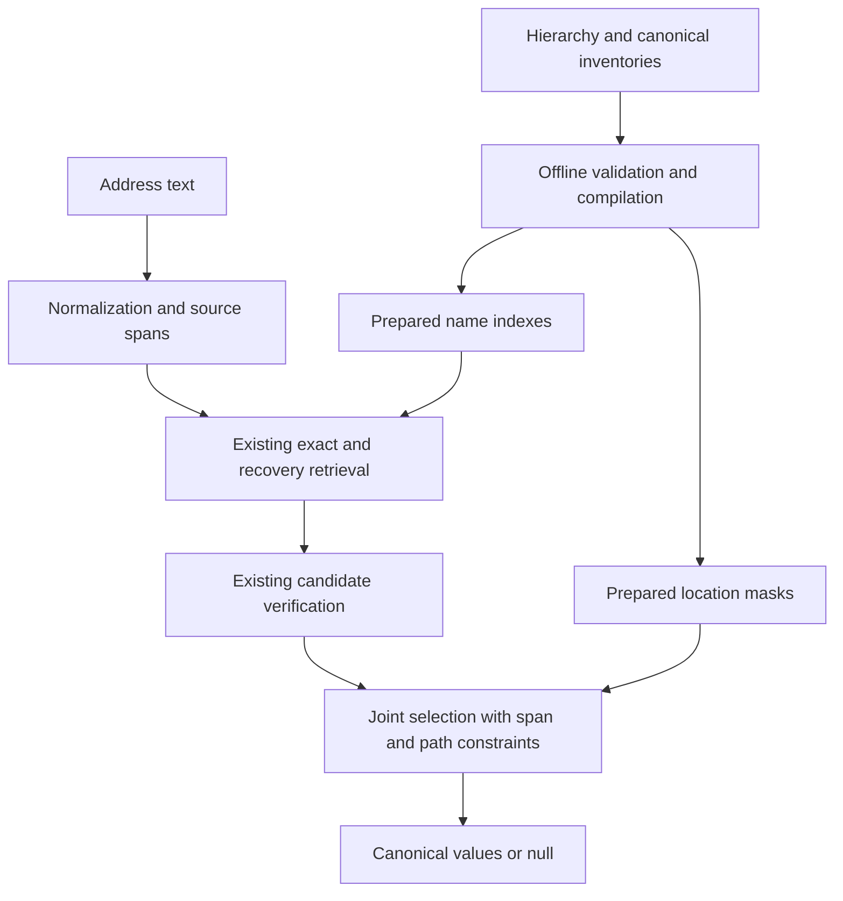

# Architecture for address hierarchy matching

Keep text matching over unique canonical names and add a hard relationship
constraint to joint selection. Compile each name's valid province–ward locations
into an integer bit mask offline, then intersect masks for selected candidates.
This separates spelling evidence from location identity, supports repeated names,
and avoids loading the 5.29 MB hierarchy in each graded process.

The isolated selection prototype matches all 1,000 original development results
and passes the local launch-to-stdout limits over 5,000 fresh processes. The
maintained package and ordinary compiler still implement flat matching. This
design specifies their integration; the prototype establishes feasibility.

## Confirmed behavior

User decisions on 2026-11-05 for `feat/support-for-hierachy`:

- The supplied hierarchy is complete and authoritative. An absent relationship
  is invalid; outside geographic data cannot override it.
- A component without supporting input text stays null, even if its value could
  be uniquely inferred from other components.
- Conflicting evidence produces the strongest consistent subset. Fields that
  remain unresolved across equally strong interpretations become null.

Retain canonical output strings, the three-field result, original source spans,
administrative marker rules, accent and typing recovery, and deterministic
budgets. The existing runtime contract remains CPython 3.14, standard library
only, a fixed dictionary prepared offline, and a fresh process for every address.
The primary timer includes launch through receipt of the complete stdout result;
the targets are mean ≤10 ms and observed maximum ≤100 ms.

## What the supplied hierarchy contains

| Quantity | Count |
| --- | ---: |
| Province names | 34 |
| Unique ward names | 319 |
| Unique street names | 162 |
| Province–ward occurrences | 2,380 |
| Valid complete paths | 166,600 |
| Streets under each province–ward occurrence | 70 |

The name inventories equal the three text dictionaries exactly. All 1,000
original expected triples occur in the hierarchy. Only 19 ward names occur in
one province; the other 300 occur in multiple provinces, up to 15. A ward name
therefore cannot have one globally assigned province.

The six accentless `Long Thanh` cases at rows 114, 208, 691, 740, 945 and 977
become uniquely resolvable using their street and province. Flat-mode
`review.json` remains valid for flat evaluation; hierarchy evaluation uses the
original expectations for these rows. Keep distinct evaluation manifests for
these two information settings.

## Represent names and locations separately

Retain the existing catalog entry for each `(field, canonical_label)`. Exact,
folded, compact, Telex/VNI and approximate indexes continue to reference these
entries. Matching a street name once must not create hundreds of candidates
for all its possible locations.

Assign a deterministic bit position to each distinct `(province, ward)` pair,
sorted by canonical labels. For a candidate label, its mask contains the
locations where that label is valid:

| Label type | Locations included in its mask |
| --- | --- |
| Province | All ward occurrences under that province |
| Ward | All occurrences with that canonical ward name |
| Street | All ward occurrences whose street list contains that name |

For three selected labels, compatibility is exactly:

```python
street_mask & ward_mask & province_mask != 0
```

A set bit identifies one province–ward occurrence containing the selected
street, which is a valid complete path. Conversely, any valid complete path
contributes a bit to all three masks. This equivalence depends on selecting at
most one label per field; extend the representation if the output schema changes.

Null means that a field supplies no constraint. With an unmentioned province,
intersect the street and ward masks but emit province null. With only one
candidate, its nonzero mask is sufficient. The all-null interpretation remains
valid even for an empty hierarchy. Preserve wards with empty street lists;
give a province with no wards a province-only bit so partial matches still work.

This representation was exhaustively compared with direct lookup for all
1,757,052 possible triples of the supplied labels, with zero discrepancies.
The 515 mask values occupy 147,339 bytes in the existing primitive record format;
each mask needs at most 298 raw bytes. The prototype index grows from 604,366
to 758,418 bytes, including keys, metadata and record overhead.

## Selection and ambiguity



Use the existing bounded joint selector. For each combination of text-supported
candidates and null choices, reject overlapping spans and empty mask
intersections. Score the remaining combinations with the existing textual
evidence scores. Relationships establish feasibility; they add no score and
do not favor labels that appear in more places.

Resolve each field from all combinations within the configured margin of the
best score. Emit a label only when it is the unique value across those
interpretations and null is absent. This implements the strongest consistent
subset without selecting a province greedily or trusting file order.

For example, suppose all three names match but their complete path is invalid.
If ward and province provide the strongest compatible interpretation, return
them and null street. If street–province and ward–province interpretations tie,
preserve province and null the other two fields. Symmetric conflicts can leave
all fields null, even though compatible pairs exist.

Pairwise membership checks are insufficient: 210,458 invalid triples in this
fixture pass street–ward, ward–province and street–province checks separately.
Those checks can refer to different ward occurrences. The common location mask
is the compatibility test for the whole selected interpretation.

Keep retrieval and verification independent of a guessed location in the first
implementation. Restricting the ward dictionary to one early province prediction
could discard the correct answer before joint scoring. Preserve existing
complete-name and marker eligibility rules; the hierarchy must not manufacture
short name fragments or replace unsupported text with a geographically possible
name.

Both the exact fast path and the recovery path must call the same constrained
selector. Complete textual coverage may still skip recovery under the current
policy, but never skips relationship validation. Hierarchy conflicts alone do
not trigger speculative correction of complete literal names.

Retain the current conservative top-K behavior: an overflowing field abstains
before it can constrain other fields. With K=8, selection has at most 729
combinations, independent of the number of hierarchy paths. Exhausted recovery
must not acquire false uniqueness through hierarchy filtering. Raising K or
adding contextual candidate pruning requires separate recall and latency
evidence; neither is needed for the supplied cases.

## Production component changes

| Component | Change |
| --- | --- |
| New `address_segmentation/hierarchy.py` | Validate hierarchy structure and canonical membership; build deterministic immutable masks against catalog entry IDs. |
| `catalog.py`, retrieval and verifiers | Continue to operate on unique canonical names and input spans. |
| `matcher.py` | Accept an optional hierarchy; provide `AddressMatcher.from_hierarchy(...)` to derive canonical inventories; pass hierarchy to both selection paths. |
| `select.py` | Accept optional mask access; intersect masks while enumerating combinations; preserve score, overlap and ambiguity semantics. |
| `io.py` | Load an explicit hierarchy input for development; reject malformed data before serving requests. |
| `prepared.py` | Expose lazy entry-ID-to-mask lookup using the mapped index and distinguish flat from hierarchical artifacts. |
| `tools/compile_dictionary.py` | Accept hierarchy as an offline build input; emit mask records and hierarchy identity into the same bundle. |
| Dataset and evaluation tools | Bind expectations and reports to hierarchy identity and inference/conflict policy; keep original and flat-reviewed evaluations separate. |

The proposed constructor accepts `hierarchy=None` for existing flat behavior.
When both inventories and a hierarchy are supplied, require equal canonical
label sets rather than silently intersecting or merging them. The factory
derives those sets when only a hierarchy is supplied. Empty hierarchies are
different from an omitted hierarchy.

Reject invalid nesting, blank/non-string names, duplicate JSON object keys,
duplicate streets within a ward, and labels outside the supplied inventory.
Repeated ward or street names at different locations are valid. Preserve exact
canonical spellings; normalized collisions retain separate masks and entry IDs.

Store one `hierarchy` mask record per entry ID in the existing mapped hash
table. Fetch masks only for distinct retained candidate IDs and reuse them
within that request. Do not reconstruct the hierarchy, deserialize every mask,
or create per-location candidates at launch.

Bump the production index format and record hierarchy presence, canonical
content identity, original file hash and policy identity alongside the existing
dictionary/runtime identities. The standalone bundle must not depend on the raw
JSON file. Include the hierarchy builder and runtime access in compiler source
generation deliberately; the research tool's AST patch is not the production
integration path. Benchmark preflight must verify hierarchy identity as well as
dictionary identity.

Extend diagnostics with relationship rejection counts, mask fetch counts and
the reason for a field's abstention. Full path examples or population counts
belong in optional traces, not ordinary results or latency measurements.

## Runtime evidence and limits

Both variants below were built from the same maintained matching source and
measured sequentially on the local CPython 3.14.4 environment. Each covers every
address in five rounds, with no cold warmups: 5,000 fresh processes per variant.

| Variant | Mean ms | p95 ms | Maximum ms | Correct outputs |
| --- | ---: | ---: | ---: | ---: |
| Flat prepared matcher | 8.724 | 10.960 | 30.239 | 4,970 / 5,000 |
| Prototype with hierarchy selection | 8.693 | 11.016 | 17.365 | 5,000 / 5,000 |

Both pass the 10 ms mean and 100 ms maximum limits under the existing
launch-to-stdout contract with `-S` and shipped checked-hash bytecode. The small
mean difference does not establish a speedup. The hierarchy prototype's
launch-to-exit mean is 10.768 ms, which fails the 10 ms limit at that endpoint.
The earlier normal-startup and source-only limitations in the
[prepared-dictionary review](prepared-dictionary.md) still apply.

The prototype adds only lazy mask lookup and compatibility checks to the
existing generated selector. Its compiler accepts dictionary and hierarchy
only; evaluation addresses and labels are separate harness inputs. It changes
exactly the six formerly ambiguous ward outputs and introduces no regressions
on these inspected development cases. These results do not establish private
test accuracy or performance at the separate 23,800-unique-street scale.

The location-mask size scales with province–ward occurrences, while text
retrieval scales with unique labels and recovery postings. Integer intersections
also grow with mask length; they are not constant-time for arbitrarily large
hierarchies. Track both dimensions in scale fixtures. Start with integer masks
for this data; consider sparse or segmented storage only if measured artifact
size and access costs justify it.

The full 168-test suite passes, including five investigation controls covering
the pairwise counterexample, deterministic assignments, empty branches, invalid
schemas, conflict ties, the strongest consistent subset and missing components.
Machine-readable evidence and source/report hashes are in
[hierarchy-investigation-results.json](hierarchy-investigation-results.json).

## Implementation stages and acceptance

1. **Catalog and hierarchy contract.** Add validated hierarchy construction and
   immutable mask access. Verify exhaustive membership equivalence and stable
   identities under input permutation, including repeated names and empty
   branches. Keep flat API tests passing.
2. **Shared selection.** Add constraints to the maintained selector and both
   matcher paths. Cover absent fields, all component orders, spans, exact-name
   conflicts, score ties, folded collisions, recovery and budget exhaustion.
   Require all 1,000 original hierarchy expectations and zero flat regressions.
3. **Prepared integration.** Extend the ordinary compiler, format identity and
   loader. Require ordinary/prepared/generated trace parity, deterministic
   builds, mismatched-hierarchy rejection and execution of a relocated bundle
   without the repository or raw hierarchy.
4. **Evaluation and timing.** Version expectation provenance; repeat all-case
   fresh-process timing on the final bundle, default startup and source-only
   controls. Add a hierarchy fixture at 23,800 unique street labels plus cases
   with many repeated names, ambiguous parents and conflicting exact matches.
   Every claimed release configuration must meet both limits at its stated
   endpoint; warm throughput cannot substitute for cold timing.

## Reproduce the investigation

Run from the repository root:

```sh
python3.14 -m tools.investigate_hierarchy --output-dir reports/hierarchy-investigation --benchmark-rounds 5
python3.14 -m unittest discover -s tests -v
```

Omit `--benchmark-rounds` for the inventory audit, exhaustive representation
check and prediction comparison without cold timings. `--cold-cases N` enables
an explicitly sampled exploratory run; the measurements above use all cases.
Generated bundles, full predictions and raw timings stay under ignored
`reports/`. The maintained package remains the flat baseline until the production
integration stages are implemented.
